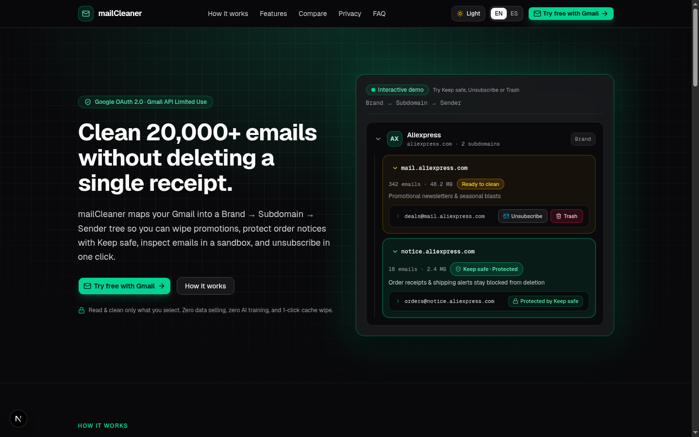
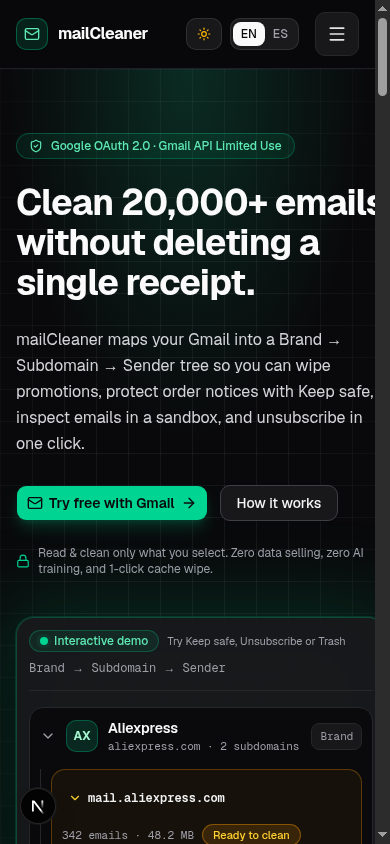
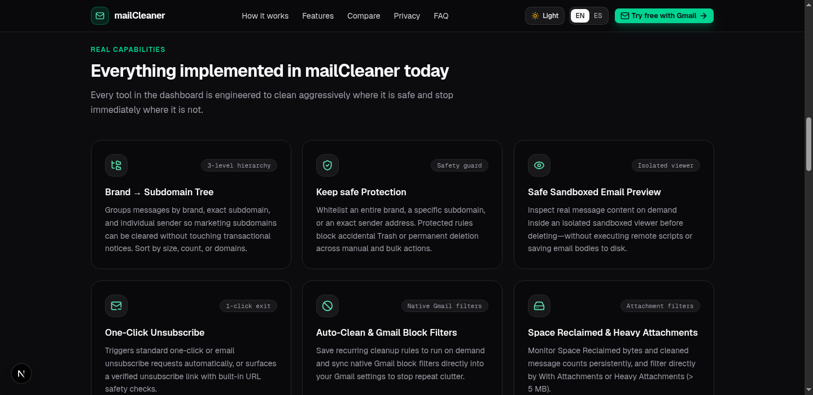
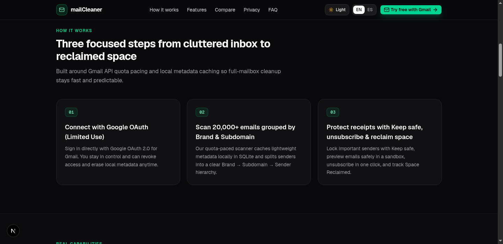
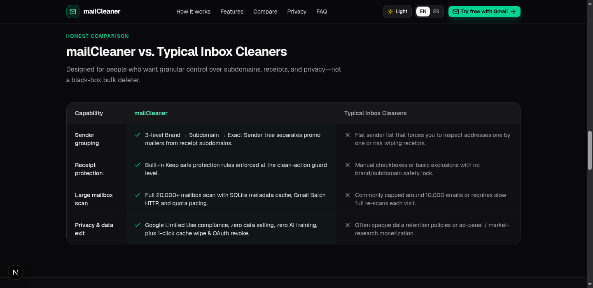
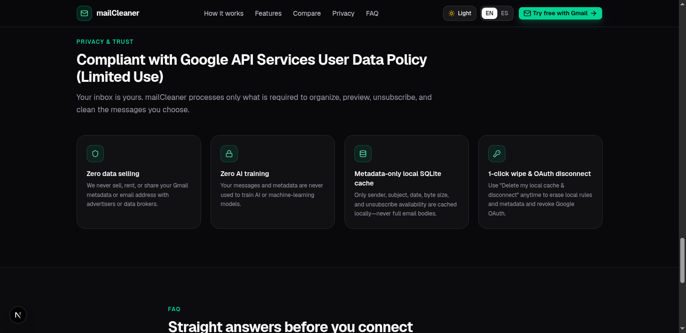
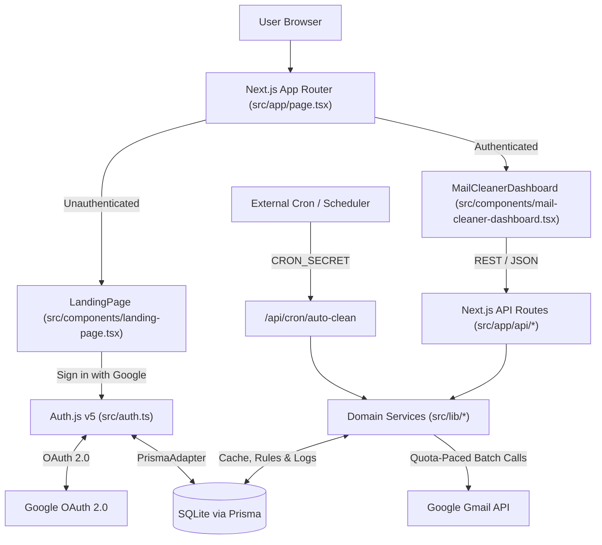

# mailCleaner

> Clean 20,000+ Gmail messages without deleting a single receipt.

**mailCleaner** is a Next.js + Prisma web application that connects to your Gmail account via Google OAuth 2.0, maps your inbox into a **Brand → Subdomain → Sender** hierarchy, and lets you bulk-clean promotions, unsubscribe in one click, protect critical senders with **Keep Safe**, and automate cleanup with **Auto-Clean** rules.

---

## Screenshots

### Landing Page (Desktop)


### Responsive Mobile View
<p align="center">
  
</p>

---

## Key Features



- **Brand → Subdomain → Sender Tree**: Groups messages into a navigable hierarchy (`src/lib/sender-tree.ts`, `src/lib/gmail-grouping.ts`) with both list and card-grid views (`src/lib/sender-list-view.ts`).
- **Keep Safe Whitelist**: Protect individual senders, domains, or brands (`SENDER | DOMAIN | BRAND`) from accidental deletion (`src/app/api/keep-safe/route.ts`, `src/lib/keep-safe.ts`).
- **Bulk Clean Actions & Trash Control**: Trash, archive, mark as read, or empty trash with reclaimed storage tracking (`src/app/api/gmail/messages/clean/route.ts`, `src/app/api/gmail/trash/empty/route.ts`).
- **One-Click Unsubscribe**: Parses `List-Unsubscribe` headers and executes unsubscribe flows (`src/app/api/gmail/unsubscribe/route.ts`, `src/lib/gmail-unsubscribe.ts`).
- **Auto-Clean Rules & Scheduled Cron**: Create `BLOCK_SENDER`, `BLOCK_DOMAIN`, or `CLEAN_QUERY` rules, preview affected messages, run manually, or trigger on a schedule via `/api/cron/auto-clean` (`src/app/api/gmail/auto-clean/*`, `src/app/api/gmail/filters/route.ts`).
- **Quota-Paced Scanning & Local Cache**: Scans large mailboxes smoothly within Gmail API limits and caches metadata locally in SQLite (`CachedMessage`) (`src/lib/gmail-quota.ts`, `src/lib/gmail-batch.ts`).
- **Sandboxed Email Preview**: Inspect message content safely before taking action (`src/app/api/gmail/messages/preview/route.ts`, `src/lib/gmail-preview.ts`).
- **Clean Activity History**: Tracks every cleanup action, message count, and reclaimed bytes (`CleanLog`, `src/app/api/gmail/history/route.ts`).
- **Privacy & 1-Click Disconnect**: Wipe cached data and disconnect your Google account cleanly (`src/components/privacy-trust-panel.tsx`, `src/app/api/account/disconnect/route.ts`).
- **Bilingual UI (EN / ES) & Dark/Light Theme**: Built-in internationalization and theme switching (`src/lib/i18n.ts`, `src/components/app-preferences-provider.tsx`).

### Workflow, Comparison & Privacy

| How It Works | Comparison |
| :---: | :---: |
|  |  |



---

## Architecture

### System Overview



### Data Model (`prisma/schema.prisma`)

- **`User`**: Stores account profile, pass status (`TRIAL | ACTIVE | EXPIRED`), `reclaimedBytes`, and `cleanedMessagesCount`.
- **`Account` / `Session` / `VerificationToken`**: Standard Auth.js models storing Google OAuth tokens and scopes.
- **`CachedMessage`**: Local metadata cache (`gmailMessageId`, `fromHeader`, `subject`, `dateIso`, `sizeBytes`, `hasUnsubscribeHeader`) for fast grouping and filtering.
- **`ProtectedRule`**: Keep Safe whitelist entries scoped by `SENDER`, `DOMAIN`, or `BRAND`.
- **`AutoCleanRule`**: Automated cleanup rules (`BLOCK_SENDER`, `BLOCK_DOMAIN`, `CLEAN_QUERY`) with schedule, `gmailFilterId`, and execution status.
- **`CleanLog`**: Audit trail of cleanup actions (`action`, `messageCount`, `bytesFreed`, `summary`).

### Project Structure

```text
├── prisma/
│   ├── schema.prisma          # SQLite database schema
│   └── migrations/            # Prisma migrations
├── src/
│   ├── auth.ts                # Auth.js v5 + Google OAuth configuration
│   ├── app/
│   │   ├── page.tsx           # Server entry point (Landing vs Dashboard)
│   │   ├── layout.tsx         # Root layout & providers
│   │   └── api/
│   │       ├── auth/[...nextauth]/
│   │       ├── account/disconnect/
│   │       ├── cron/auto-clean/
│   │       ├── keep-safe/
│   │       └── gmail/
│   │           ├── auto-clean/{preview,run}/
│   │           ├── filters/
│   │           ├── history/
│   │           ├── messages/{[id],clean,preview}/
│   │           ├── senders/
│   │           ├── trash/empty/
│   │           └── unsubscribe/
│   ├── components/
│   │   ├── landing-page.tsx
│   │   ├── mail-cleaner-dashboard.tsx
│   │   ├── privacy-trust-panel.tsx
│   │   ├── app-preferences-provider.tsx
│   │   └── ui/
│   └── lib/                   # Core business logic & unit tests (*.test.ts)
└── docs/
    └── screenshots/
```

---

## Tech Stack

- **Framework**: Next.js 16.4.6 (App Router, Turbopack), React 19.3.0, TypeScript 5
- **Styling & UI**: Tailwind CSS 4.3.3, shadcn, Base UI (`@base-ui/react`), Lucide React
- **Authentication**: NextAuth v5 (`next-auth` beta) + `@auth/prisma-adapter`
- **Database**: Prisma 6.19.3 + SQLite
- **Testing**: Node.js built-in test runner (`node --test "src/**/*.test.ts"`)

---

## Getting Started

### 1. Install dependencies

```bash
npm install
```

### 2. Configure environment variables

Copy `.env.example` to `.env` and fill in your credentials:

```env
DATABASE_URL="file:./dev.db"
AUTH_SECRET=""
AUTH_GOOGLE_ID=""
AUTH_GOOGLE_SECRET=""
CRON_SECRET=""
```

> Make sure your Google Cloud OAuth consent screen includes the Gmail scopes used in `src/auth.ts` (`https://mail.google.com/` and `https://www.googleapis.com/auth/gmail.settings.basic`).

### 3. Run database migrations

```bash
npx prisma migrate dev
```

### 4. Start the development server

```bash
npm run dev
```

Open [http://localhost:3000](http://localhost:3000) in your browser.

---

## Available Scripts

| Command | Description |
| --- | --- |
| `npm run dev` | Start Next.js development server (Turbopack) |
| `npm run build` | Build production bundle |
| `npm run start` | Start production server |
| `npm run lint` | Run ESLint |
| `npm test` | Run unit tests (`node --test "src/**/*.test.ts"`) |
